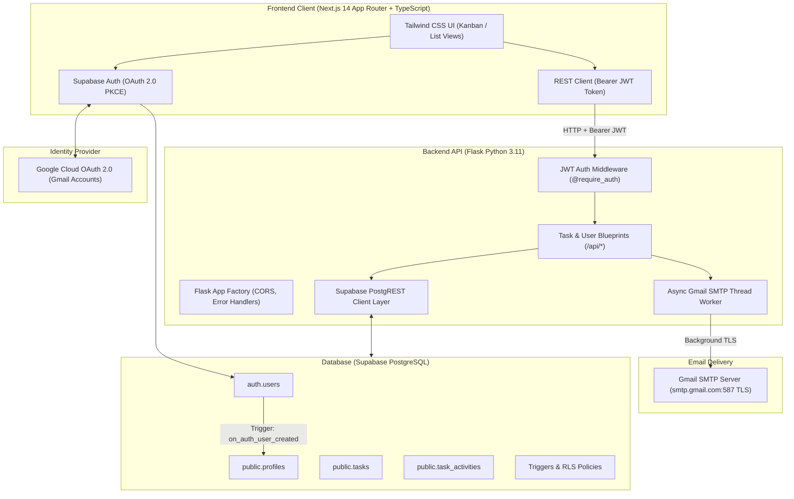

# Hairdrama Tech - Collaborative Task Management Web Application

[](https://nextjs.org/)
[](https://www.typescriptlang.org/)
[](https://flask.palletsprojects.com/)
[](https://www.python.org/)
[](https://supabase.com/)
[](https://developers.google.com/identity)
[](https://support.google.com/mail)

A production-grade, collaborative task management web application built for the **Hairdrama Tech Internship Assessment**.

---

## 🔗 Live Application & Resources

- **Frontend (Production on Vercel):** `[Your Vercel Deployment URL here]` *(e.g. `https://hairdrama-tasks.vercel.app`)*
- **Backend API (Production on Render/Railway):** `[Your Backend Deployment URL here]` *(e.g. `https://hairdrama-tasks-api.onrender.com`)*
- **Loom Video Walkthrough:** `[Your Loom Video URL here]` *(See [`docs/LOOM_SCRIPT.md`](docs/LOOM_SCRIPT.md) for script)*
- **GitHub Repository:** `[Your GitHub Repository URL here]`

---

## 🌟 Core Functionalities (Assignment Requirements)

- [x] **Google OAuth 2.0 Authentication:** Users sign in seamlessly using their Gmail / Google accounts.
- [x] **Task Creation:** Create tasks with title, description, priority (`low`, `medium`, `high`, `urgent`), status (`todo`, `in_progress`, `completed`), and due dates.
- [x] **Task Assignment to Other Users:** Assign tasks to any registered team member via dynamic user profile dropdowns.
- [x] **Automated Gmail Notifications:**
  - **Task Created:** Dispatches a branded HTML notification to the assignee detailing title, description, priority, and due date.
  - **Task Completed:** Dispatches a celebratory completion email to the task creator and assignee when a task is finished.
- [x] **Clean Migrations & RLS:** Complete SQL migrations in `/migrations` with Row Level Security and automated PostgreSQL triggers.

### 🚀 Business Enhancements (Bonus Points)
- **Kanban Board & List View:** Interactive 3-column Kanban workflow board alongside a searchable, sortable data table.
- **Audit Trail & Activity Log (`task_activities`):** Full change history tracking who created, updated, or reassigned each task.
- **Analytics KPI Dashboard:** Real-time metrics tracking Total Tasks, In Progress, Completed, Assigned to Me, and completion rate.
- **Multi-Filter & Instant Search:** Filter simultaneously by status, priority, and assignee, plus instant keyword search.
- **Non-blocking Email Architecture:** Asynchronous daemon worker threads ensure sub-50ms API response times without SMTP latency.

---

## 🏛️ System Architecture



For detailed sequence diagrams and data contracts, see [`docs/ARCHITECTURE.md`](docs/ARCHITECTURE.md).

---

## 📁 Repository Structure

```text
├── backend/                  # Flask REST API (Python 3.11)
│   ├── app.py                # App factory & blueprint registration
│   ├── config.py             # Environment configurations
│   ├── extensions.py         # Supabase client initialization
│   ├── requirements.txt      # Python dependencies
│   ├── Dockerfile            # Container definition for Render/Railway
│   ├── Procfile              # Gunicorn process definition
│   ├── routes/               # API route blueprints
│   │   ├── auth_routes.py    # /api/auth (User profile sync & me)
│   │   ├── task_routes.py    # /api/tasks (CRUD & status updates)
│   │   ├── user_routes.py    # /api/users (Team profiles list)
│   │   ├── stat_routes.py    # /api/stats (Workspace analytics)
│   │   └── health_routes.py  # /api/health (Deployment diagnostic)
│   ├── services/
│   │   ├── email_service.py  # Gmail SMTP integration with async threads
│   │   └── supabase_service.py # PostgREST database operations
│   └── utils/
│       └── auth_middleware.py# JWT verification middleware
├── frontend/                 # Next.js 14 App Router (TypeScript + Tailwind)
│   ├── src/
│   │   ├── app/
│   │   │   ├── layout.tsx    # Root layout & styling
│   │   │   ├── page.tsx      # Main Dashboard (Kanban, List, Modals)
│   │   │   ├── login/page.tsx# Google OAuth sign-in page
│   │   │   └── auth/callback/route.ts # OAuth PKCE code exchange handler
│   │   ├── components/       # Reusable UI components
│   │   │   ├── Navbar.tsx
│   │   │   ├── StatsOverview.tsx
│   │   │   ├── TaskFilters.tsx
│   │   │   ├── KanbanBoard.tsx
│   │   │   ├── TaskList.tsx
│   │   │   ├── TaskCard.tsx
│   │   │   ├── TaskModal.tsx
│   │   │   └── TaskDetailModal.tsx
│   │   ├── lib/
│   │   │   ├── supabaseClient.ts # Supabase client & OAuth helper
│   │   │   └── api.ts            # Typed HTTP client with Bearer auth
│   │   └── types/
│   │       └── index.ts          # TypeScript interfaces
│   ├── package.json
│   ├── tsconfig.json
│   └── tailwind.config.ts
├── migrations/               # Supabase PostgreSQL SQL Migrations
│   ├── 001_create_profiles.sql      # Profiles table & auth trigger
│   ├── 002_create_tasks.sql         # Tasks table, indexes & completion trigger
│   ├── 003_create_task_activities.sql # Audit logging history
│   └── 004_seed_demo_data.sql       # Analytics helper function
├── docs/                     # Technical Documentation & Interview Prep
│   ├── ARCHITECTURE.md       # Full architecture & sequence diagrams
│   ├── LOOM_SCRIPT.md        # Step-by-step Loom recording script
│   └── INTERVIEW_CHEATSHEET.md# Technical interview Q&A guide
├── .env.example              # Environment variables reference
└── README.md
```

---

## 🛠️ Local Development Setup

### Prerequisites
- **Node.js:** v18.0.0 or higher
- **Python:** 3.10 or higher
- **Supabase Account:** Free tier at [supabase.com](https://supabase.com)
- **Google Account:** With an App Password generated for Gmail SMTP.

---

### Step 1: Database Setup (Supabase)
1. Create a new project in [Supabase](https://supabase.com).
2. Go to **SQL Editor** in the Supabase Dashboard.
3. Run the SQL files in [`migrations/`](migrations/) in numerical order:
   - `001_create_profiles.sql`
   - `002_create_tasks.sql`
   - `003_create_task_activities.sql`
   - `004_seed_demo_data.sql`
4. Enable **Google OAuth** in Supabase:
   - Go to **Authentication** -> **Providers** -> **Google**.
   - Enable the provider.
   - Add your Google **Client ID** and **Client Secret** (from [Google Cloud Console](https://console.cloud.google.com/apis/credentials)).
   - Set the Redirect URL in Google Cloud Console to: `https://<YOUR-PROJECT-ID>.supabase.co/auth/v1/callback`.

---

### Step 2: Backend Setup (Flask)
1. Navigate to the backend directory:
   ```bash
   cd backend
   ```
2. Create and activate a Python virtual environment:
   ```bash
   python -m venv venv
   # Windows:
   .\venv\Scripts\activate
   # macOS/Linux:
   source venv/bin/activate
   ```
3. Install dependencies:
   ```bash
   pip install -r requirements.txt
   ```
4. Copy the environment variables:
   ```bash
   cp .env.example .env
   ```
5. Fill in your credentials in `backend/.env`:
   - `SUPABASE_URL` and `SUPABASE_KEY` / `SUPABASE_SERVICE_ROLE_KEY`
   - `GMAIL_USER` and `GMAIL_APP_PASSWORD` (16-character Google App Password)
6. Start the Flask server:
   ```bash
   python app.py
   ```
   *The API will be running at `http://localhost:5000`.* Verify at `http://localhost:5000/api/health`.

---

### Step 3: Frontend Setup (Next.js)
1. Open a new terminal and navigate to the frontend directory:
   ```bash
   cd frontend
   ```
2. Install dependencies:
   ```bash
   npm install
   ```
3. Create your `.env.local`:
   ```bash
   cp .env.example .env.local
   ```
4. Fill in:
   ```env
   NEXT_PUBLIC_SUPABASE_URL=https://your-project.supabase.co
   NEXT_PUBLIC_SUPABASE_ANON_KEY=your-supabase-anon-key
   NEXT_PUBLIC_API_URL=http://localhost:5000
   ```
5. Run the Next.js development server:
   ```bash
   npm run dev
   ```
6. Open [http://localhost:3000](http://localhost:3000) in your browser.

---

## 📧 Gmail SMTP Setup Guide

To enable automated email notifications via Gmail:
1. Go to your [Google Account Security Settings](https://myaccount.google.com/security).
2. Ensure **2-Step Verification** is turned ON.
3. Search for or navigate to **App passwords** ([direct link](https://myaccount.google.com/apppasswords)).
4. Create a new App Password named `Hairdrama Tasks`.
5. Copy the 16-character generated string and paste it into `backend/.env`:
   ```env
   GMAIL_USER=your-email@gmail.com
   GMAIL_APP_PASSWORD=xxxx xxxx xxxx xxxx
   ```
*(Note: If Gmail credentials are left blank, the app will log simulated emails to the console without crashing).*

---

## 🚀 Production Deployment Guide

### 1. Database (Supabase)
Your Supabase instance is already hosted in the cloud. Ensure your SQL migrations have been executed.

### 2. Backend Deployment (Render or Railway)
- **Option A: Render**
  1. Create a new **Web Service** on [render.com](https://render.com) connected to your GitHub repo.
  2. Set Root Directory to `backend`.
  3. Environment: `Python 3`.
  4. Build Command: `pip install -r requirements.txt`.
  5. Start Command: `gunicorn app:app --bind 0.0.0.0:$PORT`.
  6. Add environment variables: `SUPABASE_URL`, `SUPABASE_KEY`, `SUPABASE_SERVICE_ROLE_KEY`, `GMAIL_USER`, `GMAIL_APP_PASSWORD`, `FRONTEND_URL`.
- **Option B: Railway**
  1. Deploy directly using the provided `Dockerfile` or `Procfile`.
  2. Add the environment variables in Railway's dashboard.

### 3. Frontend Deployment (Vercel)
1. Import the repository on [vercel.com](https://vercel.com).
2. Set Root Directory to `frontend`.
3. Add Environment Variables:
   - `NEXT_PUBLIC_SUPABASE_URL`
   - `NEXT_PUBLIC_SUPABASE_ANON_KEY`
   - `NEXT_PUBLIC_API_URL`: Set to your deployed backend URL (e.g. `https://your-api.onrender.com`).
4. Click **Deploy**.
5. In Supabase Dashboard -> **Authentication** -> **URL Configuration**:
   - Add your Vercel URL to **Site URL** and **Redirect URLs** (`https://your-app.vercel.app/**`).

---

## 💡 Interview Preparation

Detailed technical notes and expected technical interview Q&A are compiled in:
- [`docs/INTERVIEW_CHEATSHEET.md`](docs/INTERVIEW_CHEATSHEET.md) - Deep dive on WSGI, Flask vs FastAPI, OAuth 2.0 PKCE, and RLS security.
- [`docs/LOOM_SCRIPT.md`](docs/LOOM_SCRIPT.md) - Exact script and guidelines for recording the mandatory Loom video walkthrough.

---

## 📄 License
This project was built for the **Hairdrama Tech Internship Assignment**.
