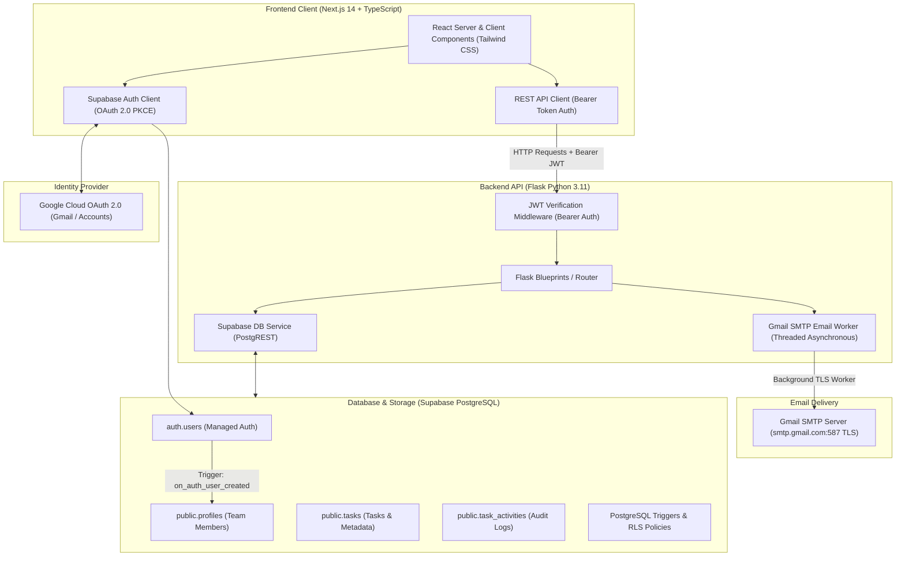
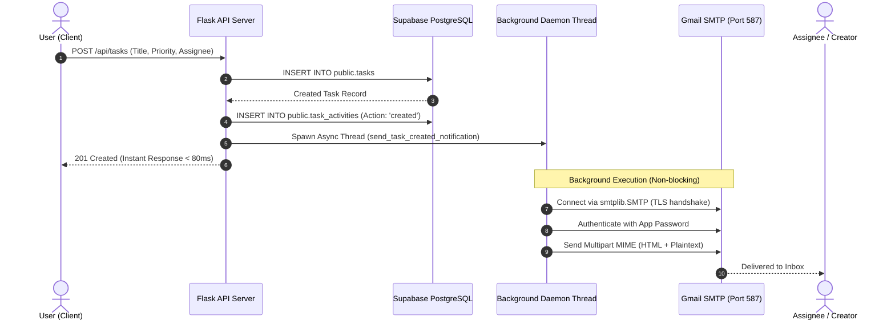
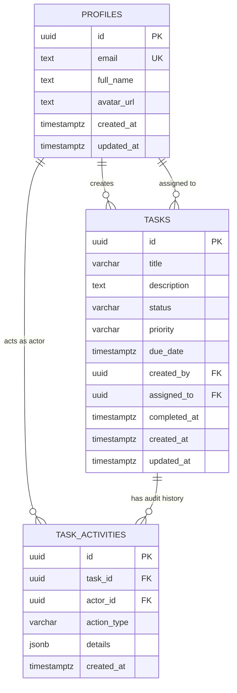

# System Architecture & Technical Specifications

This document outlines the architecture, data flow, security model, and component interactions of the **Hairdrama Collaborative Task Management System**.

---

## 1. High-Level Architecture Overview

---

## 2. Authentication & Authorization Flow (Google OAuth 2.0)

1. **User Sign-In:** The user visits `/login` and clicks **Continue with Google OAuth**.
2. **Supabase Auth Request:** Next.js invokes `supabase.auth.signInWithOAuth({ provider: 'google', options: { redirectTo: '/auth/callback' } })`.
3. **Google Consent Screen:** User approves permissions in their Google account.
4. **Code Exchange:** Google redirects back to `/auth/callback?code=...`. The Next.js Route Handler exchanges the authorization code for a session (access token and refresh token) using Supabase SSR cookies.
5. **Database Trigger:** A PostgreSQL trigger (`on_auth_user_created`) automatically extracts user metadata (`full_name`, `avatar_url`, `email`) and upserts a record in `public.profiles`.
6. **Backend Verification:** When making requests to the Flask API, the frontend includes `Authorization: Bearer <access_token>`.
7. **Auth Middleware:** Flask's `@require_auth` decorator validates the token against Supabase Auth (`supabase.auth.get_user(token)`), populating `flask.g.current_user`.

---

## 3. Asynchronous Gmail Notification System

Email delivery should never block user interaction or API response times.

---

## 4. Database Schema & Relational Integrity

### Entity Relationship Diagram (ERD)

---

## 5. Security & Row-Level Security (RLS)

- **PostgreSQL RLS:** All tables have Row-Level Security enabled (`ALTER TABLE ... ENABLE ROW LEVEL SECURITY`).
- **Profiles Policy:** All authenticated users can read profiles to populate assignment dropdowns; users can update only their own profile.
- **Tasks Policy:** Authenticated users can view team tasks, create tasks assigned to themselves or peers, update tasks where they are creator/assignee, and delete tasks they created.
- **Environment Isolation:** Secrets (`SUPABASE_SERVICE_ROLE_KEY`, `GMAIL_APP_PASSWORD`) remain exclusively on the server and are never exposed to client-side bundles.
